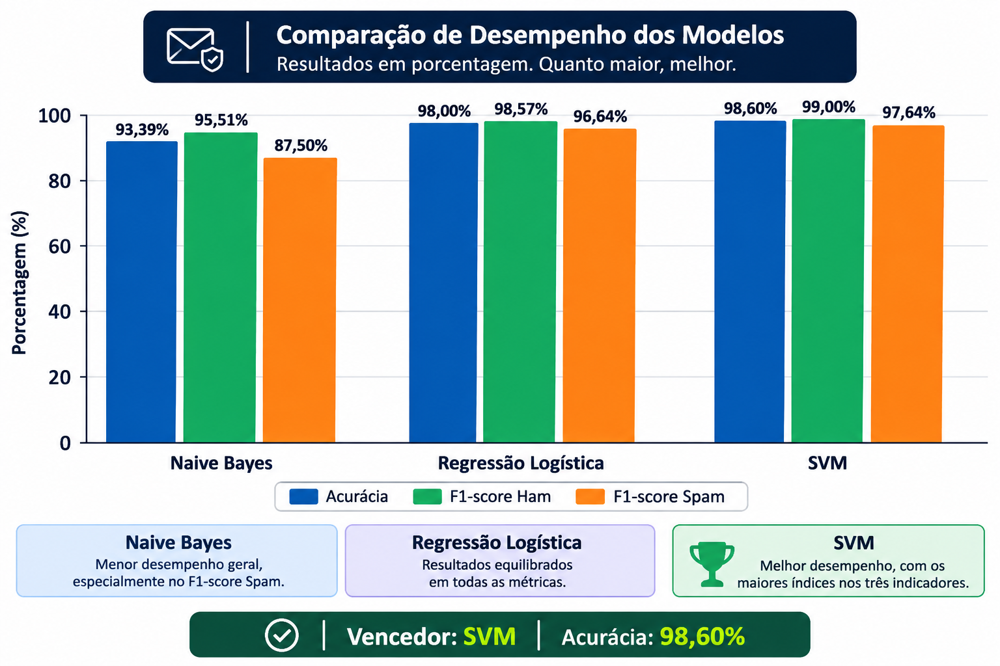
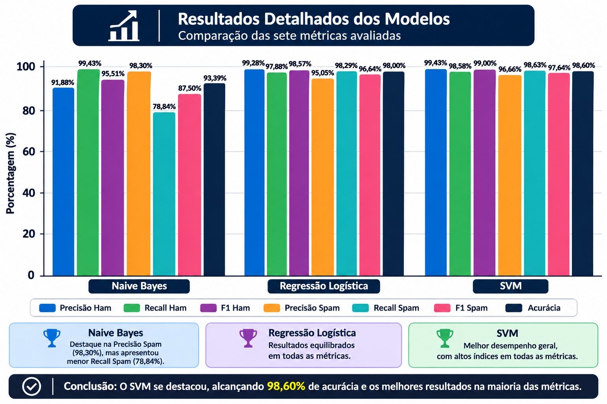
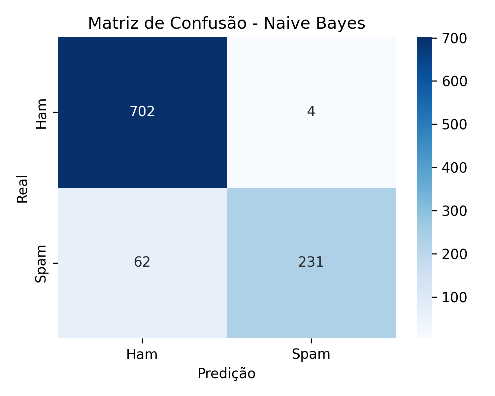
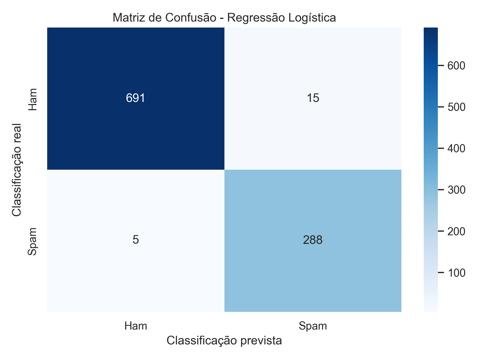
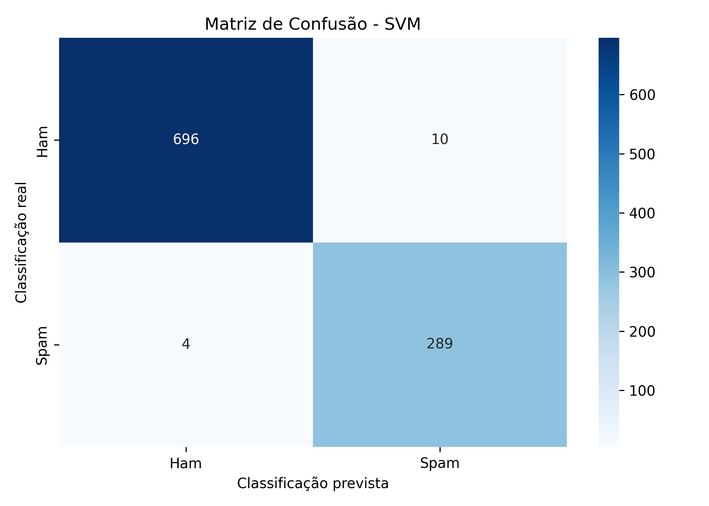

# Classificação de mensagens Spam e Ham

## Sobre o projeto

Este projeto aplica técnicas de Inteligência Artificial e Aprendizado de Máquina para classificar mensagens em duas categorias:

- **Ham:** mensagens legítimas, que não são consideradas Spam.
- **Spam:** mensagens indesejadas, como mensagens publicitárias não solicitadas ou conteúdos suspeitos.

A proposta do trabalho foi dividir o treinamento entre os integrantes do grupo. Cada integrante treinou um algoritmo diferente e, posteriormente, os resultados foram reunidos para comparar o desempenho dos modelos.

## Algoritmos utilizados

Foram avaliados três algoritmos de classificação:

- **Naive Bayes**
- **Regressão Logística**
- **SVM** (*Support Vector Machine* ou Máquina de Vetores de Suporte).

Cada algoritmo foi treinado em seu notebook correspondente. Os resultados individuais foram consolidados no arquivo `resultados/comparacao_modelos.csv`.

## Organização do repositório

A estrutura abaixo representa a organização informada para o projeto no GitHub:

```text
projeto-spam/
├── dados/
│   └── spam_ham_dataset.csv
│
├── cadernos/
│   ├── modelo_svm.ipynb
│   ├── modelo_svm.pkl
│   └── visao_geral_treinamentos.ipynb
│
├── logística/
│   ├── modelo treinado/
│   │   └── modelo_regressao_logistica.pkl
│   └── quando solicitado use/
│       ├── spam_ham_dataset.csv
│       ├── Regressao_Logistica_Spam_Ham.ipynb
│       └── modelo_regressao_logistica.pkl
│
├── resultados/
│   ├── naive_bayes/
│   │   ├── matriz_confusao.csv
│   │   ├── matriz_confusao.png
│   │   └── metricas.csv
│   │
│   ├── regressao_logistica/
│   │   ├── matriz_confusao.csv
│   │   ├── matriz_confusao.png
│   │   └── metricas.csv
│   │
│   ├── svm/
│   │   ├── matriz_confusao.csv
│   │   ├── matriz_confusao.png
│   │   └── metricas.csv
│   │
│   ├── graficos/
│   │   ├── comparacao_desempenho_modelos.png
│   │   └── resultados_detalhados_modelos.png
│   │
│   └── comparacao_modelos.csv
│
├── .gitignore
├── Naive_Bayes.ipynb
├── requirements.txt
├── README.md
└── RESULTADOS_GERAIS.md
```

## Dados utilizados na avaliação

Conforme os resultados consolidados em `resultados/comparacao_modelos.csv`, cada modelo utilizou:

- **Treinamento:** 3.994 registros.
- **Teste:** 999 registros.

A utilização da mesma quantidade de registros permite comparar os resultados dos algoritmos nas condições registradas no experimento. A origem do conjunto de dados, a quantidade total de registros e as etapas de pré-processamento devem ser consultadas nos notebooks do projeto.

## Métricas de avaliação

Para comparar os algoritmos, foram utilizadas as seguintes métricas:

| Métrica | Descrição |
|---|---|
| **Acurácia** | Percentual de classificações corretas em relação ao total de registros avaliados. |
| **Precisão** | Proporção de previsões de uma classe que realmente pertencem a ela. |
| **Recall** | Proporção de registros reais de uma classe que foram identificados pelo modelo. |
| **F1-score** | Medida que combina precisão e recall, permitindo avaliar o equilíbrio entre as duas métricas. |

As métricas de precisão, recall e F1-score foram registradas separadamente para Ham e Spam, permitindo observar o desempenho de cada modelo nas duas classes.

## Resultado comparativo

A tabela apresenta um resumo dos resultados obtidos pelos três algoritmos:

| Modelo | Acurácia | F1-score Ham | F1-score Spam |
|---|---:|---:|---:|
| Naive Bayes | 93,39% | 95,51% | 87,50% |
| Regressão Logística | 98,00% | 98,57% | 96,64% |
| SVM | **98,60%** | **99,00%** | **97,64%** |

O detalhamento das métricas está disponível em `resultados/comparacao_modelos.csv` e nos arquivos `metricas.csv` de cada algoritmo.

## Comparação visual dos modelos

Os gráficos abaixo apresentam uma comparação visual do desempenho dos três algoritmos avaliados.

### Comparação de Desempenho dos Modelos

Este gráfico apresenta a comparação da acurácia e dos F1-scores de Ham e Spam dos três algoritmos.



### Resultados Detalhados dos Modelos

Este gráfico apresenta as métricas de precisão, recall e F1-score para Ham e Spam, além da acurácia.



## Matrizes de confusão

As matrizes de confusão permitem visualizar a quantidade de classificações corretas e incorretas realizadas por cada algoritmo, mostrando como as mensagens Ham e Spam foram identificadas pelos modelos.

### Matriz de Confusão — Naive Bayes



### Matriz de Confusão — Regressão Logística



### Matriz de Confusão — SVM



## Melhor resultado

O SVM apresentou o melhor desempenho geral entre os três modelos avaliados. Alcançou acurácia de **98,60%**, além dos maiores F1-scores para Ham (**99,00%**) e Spam (**97,64%**).

A Regressão Logística também apresentou resultados consistentes, com acurácia de 98,00%. O Naive Bayes obteve acurácia de 93,39% e F1-score de 87,50% para Spam. Na análise registrada do experimento, esse modelo apresentou recall inferior para essa classe.

Uma análise dos resultados e das matrizes de confusão está disponível em `RESULTADOS_GERAIS.md` e nos arquivos da pasta `resultados/`.

## Como consultar e executar o projeto

Acesse o notebook correspondente ao algoritmo que deseja consultar:

- **Naive Bayes:** `Naive_Bayes.ipynb`.
- **Regressão Logística:** `logística/quando solicitado use/Regressao_Logistica_Spam_Ham.ipynb`.
- **SVM:** `cadernos/modelo_svm.ipynb`.

Verifique no próprio notebook as etapas de preparação dos dados, treinamento e avaliação.

Para consultar os resultados:

1. Acesse a pasta `resultados/` para visualizar as métricas e as matrizes de confusão.
2. Abra `resultados/comparacao_modelos.csv` para consultar a comparação consolidada.
3. Consulte `RESULTADOS_GERAIS.md` para conferir a análise dos resultados.

Os notebooks podem ser abertos em ambientes compatíveis com Jupyter, como o Google Colab. As bibliotecas necessárias estão relacionadas em `requirements.txt`. As versões e eventuais instruções adicionais devem ser verificadas nesse arquivo e nas importações dos notebooks.

## Conclusão

O experimento permitiu comparar três algoritmos de aprendizado de máquina aplicados à classificação de mensagens Ham e Spam. Com base nos resultados registrados, o SVM obteve o melhor desempenho geral, seguido pela Regressão Logística e pelo Naive Bayes.

A comparação mostra como diferentes algoritmos podem apresentar desempenhos distintos na mesma tarefa e reforça a importância de analisar mais de uma métrica antes de escolher o modelo mais adequado.
