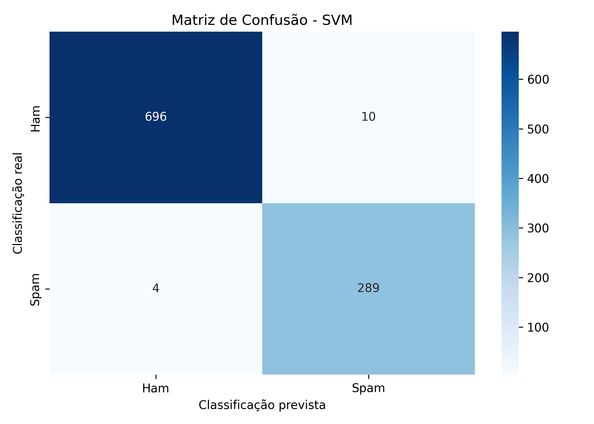

# Resultados Gerais — Comparação dos Modelos

## 1. Objetivo

Este documento reúne os resultados de três algoritmos de aprendizado de máquina treinados individualmente para a classificação de mensagens nas categorias Ham (mensagens legítimas) e Spam (mensagens indesejadas).

A comparação considera as métricas de acurácia, precisão, recall e F1-score para as duas classes, além da quantidade de registros utilizados no treinamento e no teste.

Os resultados consolidados podem ser consultados em `resultados/comparacao_modelos.csv`. Os resultados individuais estão organizados nas pastas `resultados/naive_bayes/`, `resultados/regressao_logistica/` e `resultados/svm/`.

## 2. Configuração da avaliação

De acordo com o arquivo `resultados/comparacao_modelos.csv`, os três modelos utilizaram a mesma quantidade de registros:

- **Treinamento:** 3.994 registros.
- **Teste:** 999 registros.

A utilização da mesma quantidade de registros permite comparar os resultados apresentados pelos algoritmos na avaliação. A origem dos dados e as etapas de preparação devem ser consultadas nos notebooks correspondentes.

## 3. Comparação dos resultados

Os valores abaixo foram obtidos do arquivo `resultados/comparacao_modelos.csv`. As métricas estão apresentadas em porcentagem, com duas casas decimais.

| Modelo | Acurácia | Precisão Ham | Recall Ham | F1-score Ham | Precisão Spam | Recall Spam | F1-score Spam |
|---|---:|---:|---:|---:|---:|---:|---:|
| Naive Bayes | 93,39% | 91,88% | 99,43% | 95,51% | 98,30% | 78,84% | 87,50% |
| Regressão Logística | 98,00% | 99,28% | 97,88% | 98,57% | 95,05% | 98,29% | 96,64% |
| SVM | 98,60% | 99,43% | 98,58% | 99,00% | 96,66% | 98,63% | 97,64% |

### 3.1. O que cada métrica representa?

- **Acurácia:** proporção de todas as mensagens classificadas corretamente.
- **Precisão:** entre as mensagens que o modelo classificou como uma determinada classe, quantas realmente pertenciam a ela.
- **Recall:** entre todas as mensagens que realmente pertenciam a uma classe, quantas foram identificadas pelo modelo.
- **F1-score:** média harmônica entre precisão e recall, permitindo avaliar o equilíbrio entre as duas métricas.

As métricas de Ham e Spam devem ser observadas separadamente, pois um modelo pode apresentar bom resultado em uma classe e desempenho inferior na outra.

## 4. Análise dos modelos

### Naive Bayes

O Naive Bayes apresentou acurácia de 93,39%. Seu principal destaque foi a precisão para Spam, de 98,30%, a maior entre os três modelos. Entretanto, o recall de Spam foi de 78,84%, indicando que uma parcela maior das mensagens indesejadas não foi identificada em comparação aos outros algoritmos.

Os resultados individuais estão disponíveis em:

- `resultados/naive_bayes/metricas.csv`
- `resultados/naive_bayes/matriz_confusao.csv`
- `resultados/naive_bayes/matriz_confusao.png`

### Regressão Logística

A Regressão Logística alcançou acurácia de 98,00% e apresentou resultados equilibrados entre as classes. Para Spam, obteve recall de 98,29% e F1-score de 96,64%. Seu desempenho foi superior ao Naive Bayes nas principais métricas gerais, especialmente na identificação de mensagens Spam.

Os resultados individuais estão disponíveis em:

- `resultados/regressao_logistica/metricas.csv`
- `resultados/regressao_logistica/matriz_confusao.csv`
- `resultados/regressao_logistica/matriz_confusao.png`

### SVM

O SVM obteve a maior acurácia, de 98,60%, e os melhores valores de F1-score para Ham (99,00%) e Spam (97,64%). Também apresentou o maior recall para Spam, de 98,63%, entre os modelos comparados.

Esses resultados indicam que o SVM teve o melhor equilíbrio geral na classificação das duas categorias e identificou a maior proporção de mensagens Spam.

Os resultados individuais estão disponíveis em:

- `resultados/svm/metricas.csv`
- `resultados/svm/matriz_confusao.csv`
- `resultados/svm/matriz_confusao.png`

## 5. Matriz de confusão do SVM

A matriz de confusão abaixo apresenta a quantidade de classificações corretas e incorretas do SVM no conjunto de teste.

Considerando as linhas como as classes reais e as colunas como as classes previstas:

| Classe real | Previsto como Ham | Previsto como Spam |
|---|---:|---:|
| Ham | 696 | 10 |
| Spam | 4 | 289 |

No total, foram 985 classificações corretas e 14 classificações incorretas, entre os 999 registros de teste.

- 696 mensagens Ham foram classificadas corretamente.
- 289 mensagens Spam foram classificadas corretamente.
- 10 mensagens Ham foram classificadas incorretamente como Spam.
- 4 mensagens Spam foram classificadas incorretamente como Ham.

A matriz confirma o bom desempenho do SVM na identificação das duas classes, com apenas quatro mensagens Spam classificadas como Ham.

**Matriz de confusão do SVM:**

O arquivo da matriz também está disponível em `resultados/svm/matriz_confusao.csv`.

## 6. Resultado geral e conclusão

Com base nas métricas disponibilizadas, o SVM foi o modelo com melhor desempenho geral entre os três algoritmos avaliados. Ele apresentou a maior acurácia (98,60%) e os maiores F1-scores para Ham (99,00%) e Spam (97,64%), além do maior recall para Spam (98,63%).

A Regressão Logística também apresentou resultados próximos aos do SVM, com acurácia de 98,00%, demonstrando um desempenho consistente. Já o Naive Bayes teve a maior precisão para Spam, mas seu recall nessa classe foi consideravelmente menor, o que significa que deixou de identificar mais mensagens indesejadas.

Portanto, considerando o conjunto de métricas e o objetivo de classificar corretamente mensagens legítimas e indesejadas, o SVM foi o algoritmo que apresentou os resultados mais satisfatórios neste experimento.

**Observação:** esta conclusão se refere aos dados e às condições de avaliação registradas no projeto. Os resultados não garantem o mesmo desempenho em outros conjuntos de mensagens. A comparação também não substitui a documentação das configurações específicas de cada treinamento.
